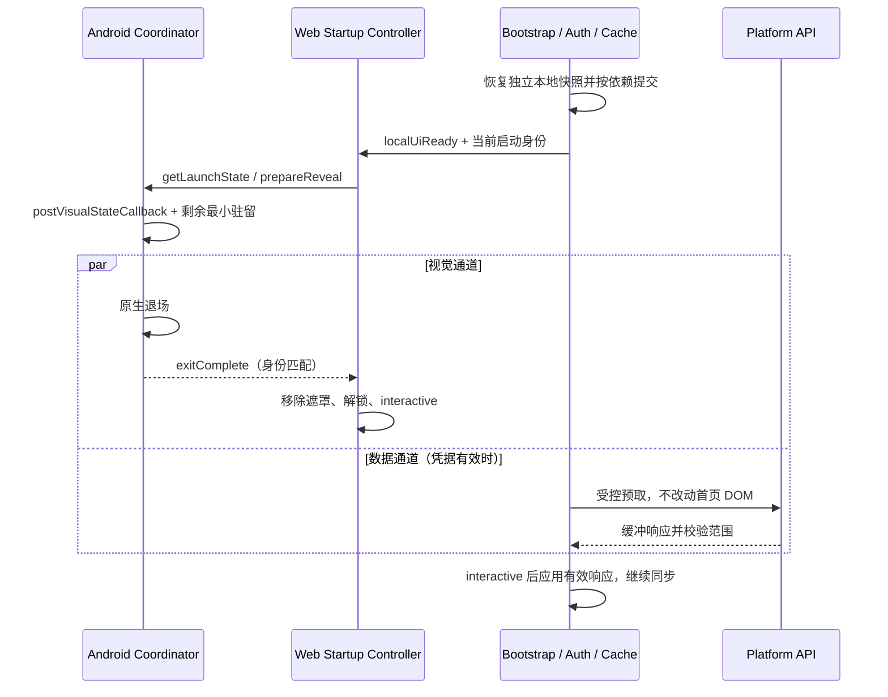

# IoT Manager Glass 启动动画与启动链路开发文档

文档版本：v1.1（补充实施状态）<br>
日期：2026-10-18（Asia/Shanghai）<br>
实施对象：`apps/client-glass-next`<br>
设计基线：`1.1.4-glass.5`；包名 `com.iot.manager.glassnext`；当时 Android versionCode=10<br>
核对时 Git HEAD：`0c0ed0393f880d6483ce72632bdaa8980a3a4afe`<br>
状态：**已在独立 Glass 工程实现并生成 `1.1.4-glass.6 / code 11` 调试包；自动化和模拟器证据、实验开关及实机待验项见[实施与测试记录](GLASS-STARTUP-ANIMATION-IMPLEMENTATION-2026-10-18.md)。本文的源码核对表保留设计时基线。**

## 1. 输入、目标与实施范围

根据用户提供的`iot_manager_startup_animation_plan.md`（用户附件，未纳入仓库），将“缩短人为等待、加载有反馈、图标一致、请求与动画解耦、取消高频探测、统一故障处理”转化为当前源码可实施的开发任务。

附件中的反编译诊断、补丁和收益数字属于待核对的方案材料。实现以当前工程真实模块为入口，不编辑 `classes*.dex`、反编译函数 `Rc/Qd/Pi` 或带哈希的 `index-*.js`，不直接替换整个 HTML/CSS。

本轮范围包括：启动状态机、首屏本地恢复、受控远程预取、Android/Web 可见层、图标/底色、故障恢复、动效降级、启动指标及回归。设备控制、AI 问答、玻璃页面结构、认证协议和后端 API 沿用原契约。

工程已有[启动整改方案](GLASS-STARTUP-ANIMATION-PLAN-2026-10-18.md)，包含 1000ms 驻留的节奏试验。本文细化开发契约，并将最新附件的 180/160ms 作为快速配置候选，与现有 800/700ms 基线对照；不同时把 1000ms 和 180ms 写成同一默认值。最终节奏由同机数据与观感选定。

## 2. 源码基线与附件结论校正

| 项目 | 当前源码核对 | 开发结论 |
| --- | --- | --- |
| Android 驻留/退场 | `MIN_HOLD_MS=800`，`EXIT_MS=360`，动画兜底为 EXIT_MS+180 | 可试验缩短；驻留按累计 elapsed 计算，不在就绪后重新等待完整时长 |
| Web 驻留/退场 | `STARTUP_VISUAL_TARGET_MS=700`，`STARTUP_EXIT_MS=280`，兜底为退出时长+120 | 用于浏览器及 Web 回退；正常 Android 路径隐藏 Web 遮罩，由原生退场负责 |
| 双遮罩问题 | Android 隐藏 Web 遮罩，等待匹配 `exitComplete` 后移除并解锁 | 不能将两套时长简单串加；仍须验证故障回退是否露出旧遮罩/错误文案 |
| 首屏同步 | `activateEndpoint()` 等 `startupReady()` 完成，再刷新临期令牌及执行 `synchronizePlatformEndpoint()` | 动画确实阻挡了后续同步；应分离请求获取、状态应用和视觉完成 |
| 本地恢复 | 安装 ID→绑定与逐个活动历史→待定位→站点设置→端点设置→启动 URL | 存在串行开销；不是所有步骤都无依赖或纯读取，不能整体套用 Promise.all |
| 认证路径 | 端点确定后恢复身份；OIDC 回调可能在 startupReady 前处理；临期刷新在其后 | 并行化必须保留认证、回调与端点作用域；不得使用旧身份预取 |
| 系统图标 | 活跃主题引用 `@mipmap/ic_launcher_foreground`，不是附件点名的 drawable-v24 资源 | 先核对资源映射及实际截图，不能直接认定当前启动窗使用默认机器人 |
| 底色 | Android `startup_background=#F3F6F7`；Web 启动底色 `#eff5f6` | 可统一到 #eff5f6；图标底色与内容主题分开管理 |
| 120ms 探测 | `probeWebFallback()` 查询 Web 遮罩图片并申请可见帧确认；ready/prepared/timeout 等会停止 | 改为有身份校验的事件通知及有上限退避，保留无桥接/无 JS 兜底 |
| 看门狗 | Web 600ms 等待、4s 失败；原生 8s 恢复、9.5s 救援信息；桥接前失败另有 9s Web 等待 | 时间及起点不同；仅改 4s→7.5s 不足以消除竞态，要统一状态与可见层责任 |
| 触控 | 退场期间 `#app.inert=true`；完成事件后解锁 | 保留遮挡期保护，避免用户点到尚不可见的设备控制 |

代码依据：[Web transition](../src/js/platform/startup-transition.js)、[启动入口](../src/main.js#L623)、[本地恢复](../src/main.js#L1260)、[原生协调器](../android/app/src/main/java/com/iot/manager/glassnext/StartupCoordinator.java)、[主题](../android/app/src/main/res/values/styles.xml)、[看门狗](../public/startup-watchdog.js)。

附件所称“提前 1.1 秒、I/O 降低 45%、全程 60fps”均作为假设，不作为本项目验收结论。当前源码版本和 code 也不自动证明已安装 APK 的版本，实机测试需另外核对包信息及摘要。

## 3. 总体架构与就绪定义

### 3.1 三类就绪分别管理

| 事件 | 完成条件 | 可以做什么 |
| --- | --- | --- |
| `localUiReady` | 当前范围的端点/身份状态已确定；本地 shell 或明确错误/登录态已渲染；事件委托可工作 | 请求首帧确认与退场；满足凭据条件时启动受控读取 |
| `interactive` | 当前可见遮罩已经退出；本地 shell 有效；身份/控制许可仍有效 | 解除 inert/aria-hidden，恢复焦点并执行延后任务 |
| `initialDataSettled` | 首批远程同步成功，或失败/离线状态已明确展示 | 完成数据区 loading；记录首批数据与可用模式 |

不要使用一个 `ready` 同时表示本地画面、动画结束、远程数据成功。离线或未登录可以进入对应的可用页面，缓存仍只读；动画结束不能打开控制许可。OIDC 回调未完成时可先展示受限认证状态壳，但不能以此认定身份已完成。

### 3.2 可见层只保留一个负责人

第一阶段沿用现有架构：Android 由原生盖板负责退出；浏览器及确认原生交接成功后的 Web fallback 由 Web 遮罩负责。正常 Android 不再额外播放完整 Web 启动退场。



原文“WebView 首帧提交后立即移除原生盖板”的 Web 主导模式作为第二阶段可选方案。启用前必须增加独立的 **Web cover ready→原生确认→盖板移除→Web 接管** 协议，不能复用“主页可退场”的 prepareReveal 当作加载遮罩就绪。

`onPageCommitVisible()` 只说明新导航可以替代旧内容，CSS/图片可能尚未加载，不能单独证明页面或 Web 遮罩已经绘好；继续用 `postVisualStateCallback()` 确认所需 DOM 状态可绘制，并满足 WebView 可见/挂载等条件。该回调也不是物理显示已呈现或帧率达标的证明。[WebViewClient 文档](https://developer.android.com/reference/android/webkit/WebViewClient#onPageCommitVisible(android.webkit.WebView,%20java.lang.String))、[WebView 文档](https://developer.android.com/reference/android/webkit/WebView#postVisualStateCallback(long,%20android.webkit.WebView.VisualStateCallback))。

### 3.3 启动状态机

```text
SYSTEM_SPLASH → NATIVE_COVERING → FRAME_READY → NATIVE_EXITING → INTERACTIVE
                        │
                        ├─ 超时/确定故障 → NATIVE_RECOVERY → 重试（新 attempt）
                        └─ 已确认交接 → WEB_COVERING → WEB_EXITING → INTERACTIVE

浏览器：WEB_COVERING → WEB_EXITING → INTERACTIVE
              └─ 超时/确定故障 → WEB_ERROR → 重试（新页面/新 attempt）
销毁：任意非终态 → DISPOSED
```

约束：

- `NATIVE_EXITING` 与 `WEB_EXITING` 不能同时成为本次正常启动的视觉负责人。
- 完成、恢复与销毁动作幂等；每个 attempt 只发布一次 interactive 或失败结果。
- 恢复页一旦成为当前终态，迟到 ready 不自动穿过恢复页；由明确重试开启新 attempt。
- dispose 清理并以取消结束 Promise；不得调用“正常成功完成”顺带解锁已销毁页面。
- `markUiReady()` 重复调用返回同一个在途 Promise，而不是立即返回 false 或另启动一轮。

## 4. 参数与时钟契约

以下为开发初值，候选配置必须经过同机对照，不代表已经调优。

| 参数 | 当前 | 建议候选/语义 |
| --- | --- | --- |
| Native 最小驻留 | 800ms | 快速配置 180ms；按 Activity 单调时钟累计，不与 Web 160ms 串加 |
| Native 退场 | 360ms | 340ms；单图标可选轻缩放，默认盖板只透明度变化 |
| Native 退场兜底 | 540ms | 480ms，自退场开始计；幂等移除盖板再发布完成 |
| Web 最小可见时长 | 700ms | 160ms，自 Web 遮罩首个可绘制机会累计 |
| Web 退场 | 280ms | 360ms；CSS、JS 与 transitionend 过滤保持一致 |
| Web 退场兜底 | 400ms | 500ms，自退场开始计；只认遮罩自身 opacity 结束 |
| 等待提示 | 600ms | 500ms；在实际可见负责人层提供反馈 |
| 慢启动提示 | 4s 即失败 | 4s 改为非致命 slow，不展示确定失败或强制跳转 |
| Web 重试提示 | 4s | 7.5s 仅在 Web 是负责人时提供“仍在准备，可重试”状态 |
| Native 故障恢复 | 8s | 初期保留 8s，从同一 Native attempt 起点计 |
| 完成事件救援 | Native 9.5s / Web 9s 相对等待并存 | Native 提供剩余预算/phase，Web 不另起互相矛盾的固定 9s 时钟 |
| 探测退避 | 120ms 循环 | 事件优先；备用间隔候选 250/500/1000/1000ms，最多 4 次；另保留 8s 恢复 |
| 图标轻呼吸 | 当前静态 | 原生 1→1.015→1、周期 1800–2400ms；仅覆盖可见等待期 |

减少动画或系统动画关闭时，跳过装饰驻留和动效，仍等待合法本地 UI 与必要帧确认。慢启动已经超过最小驻留时，首帧就绪后直接退场，不再等完整周期。

时钟使用 Native `SystemClock.elapsedRealtime()` 与 Web `performance.now()`；不能直接相减。通过桥接往返记录时间锚点及误差范围，性能记录保存两个时钟域。Web 模块开始前的 watchdog 起点与 Native 起点必须明确，不能将 7.5s/8s 的差值误当固定 500ms 安全裕量。

## 5. 启动本地 I/O 与业务同步开发

### 5.1 拆分首屏必需数据与延后数据

| 任务 | 依赖与实现 | 失败/超时策略 |
| --- | --- | --- |
| 安装 ID | 单次读取/必要时生成写回；避免并发生成多份 | 沿用临时 ID 降级，不能据此写入错误安装分区 |
| BLE 绑定摘要 | 读取元数据；按安装身份确认可应用范围 | 首屏按 OFFLINE/DISCONNECTED 展示，不把缓存当活连接 |
| BLE 历史 | 从 `restoreLocalBindings()` 内循环移出首屏门槛 | interactive 后或打开详情时按需读取，显示 loading/error |
| 站点选择、端点、待定位记录 | 独立读取快照，可并发；提交顺序固定 | 各自降级；待定位仍须按 platformCacheScope 匹配 |
| 启动 URL | 与只读本地设置并发获取 | 失败明确记录；回调重放和 state 校验仍走认证模块 |
| OIDC 会话恢复 | 依赖最终端点/issuer/clientId，不能提到其前 | 临期刷新或回调交换保持原认证顺序；失败不使用旧令牌 |
| 平台缓存 | 依赖已知认证分区、组织及站点 | 只应用当前分区，标注 stale/只读 |

实现 `readStartupSnapshot()` 和 `applyStartupSnapshot()` 的职责分离：前者只返回结果，后者校验 attempt/context 后按固定顺序更新 Store。已有会直接写 Store 的函数先拆分，再并行执行。

独立可选读取使用 Promise.allSettled；每项附自己的软截止与降级，避免一个挂起 Promise 令 allSettled 永不返回。软截止不是取消底层 I/O；迟到结果必须丢弃或重新校验。认证交易、写操作及安装 ID 生成不能通过超时后重复发起来“加速”。

`listLocalActivity()` 当前返回全部历史，没有分页参数。拟新增按 bindingKey、游标及 limit 读取的接口和测试，必要时为时间排序增加 IndexedDB 索引并执行 schema 迁移；不能把全量读完再 slice 当作 I/O 分页。首屏只恢复设备摘要，历史延后加载，不做无限并发读所有绑定。

### 5.2 解耦退场 Promise 与请求执行

当前阻塞点在 [activateEndpoint](../src/main.js#L674)：`await startupReady()` 会等待整个退场。需要把本地 UI 事件与视觉完成 Promise 分开。

建议流程（职责伪代码，不是可直接粘贴的补丁）：

```text
snapshot = await readStartupSnapshotWithDegradation()
context = await applyEndpointAndRestoreAuth(snapshot)
renderLocalShell(context)                     // 登录/回调中亦可呈现受限壳
reveal = startup.markUiReady()                // 立即发起；保存并处理结果

if context.hasValidToken && !context.authExchangeInFlight:
    prefetch = fetchSitesSnapshot(context)    // 只获取，不调用 loadSites 的 UI 副作用

visualResult = await reveal
if visualResult != interactive or !contextStillCurrent:
    cancelOrDiscardPrefetch()
    stopThisAttempt()
else:
    await refreshTokenIfRequired()            // 未满足凭据条件的路径此时处理
    applyValidPrefetchOrLoadSites()
    synchronizeDevicesAndWeatherInOrder()
    recordInitialDataSettled()
    scheduleLocalHistoryOnDemand()
```

预取封装需立刻接住错误并返回结构化结果，避免在等待动画期间产生未处理 rejection。`markUiReady()` 的异常/false 不能 `.catch(()=>{})` 后当成功；bootstrap 也不能无条件写 startup.phase=ready。

第一阶段仅预取满足条件的站点读取；设备和天气在站点确定后继续原顺序。待同机帧数据证明可承受，再扩展其他读取。不要将 `synchronizePlatformEndpoint()` 整体并行跑到退场中：它会恢复缓存、选择站点、更新 Store 及页面，可能引入重绘和身份竞态。

所有预取结果绑定 endpointActivationRevision、session revision、组织/站点及 attempt，端点改变、退出或重试均失效。相同读取使用 single-flight，避免预取和原 loadSites 各发一次。启动优化只读业务数据，不引入设备命令重发。

## 6. Native/Web 协议与故障恢复

### 6.1 现有接口及拟扩展字段

| 接口 | 当前契约 | 开发要求 |
| --- | --- | --- |
| `getLaunchState()` | 返回 launchId、phase、remainingWebRescueMs | 保留兼容字段；拟增加 protocolVersion、activityInstanceId、coverOwner、elapsedMs |
| `prepareReveal()` | 入参 launchId/reducedMotion，返回 accepted | 校验当前身份、合法阶段、WebView 挂载和可见；仅表示受理，不等于完成 |
| `exitComplete` | 事件携带 launchId | 新协议带 activityInstanceId；先移除盖板再发布；重复事件不二次解锁 |
| `reportWebCoverReady()` | 当前不存在，拟新增 | 只确认回退遮罩图片/替代图形与关键样式就绪；不能解锁主页 |
| Watchdog `stop()/fail()` | 已存在 | 保持兼容；拟新增 state/owner/attempt 通知，不用附件中的 ready() 替换 stop() |

现有 launchId 在单个 Activity 内递增，重建 Activity 又从 1 开始。新协议以 `(activityInstanceId, launchId)` 关联回调，Web reload 另持 pageAttempt；旧异步 listener 注册返回后如已销毁，必须立即 remove，不能留给下轮启动。

Web 启动顺序：先安装完成监听，再读取 launchState、隐藏 Web 后备遮罩并申请 prepareReveal。若 phase 已 COMPLETE，可在身份匹配、壳有效且原生确认盖板已移除时完成；若 EXITING，继续等待/查询。桥接拒绝或未知阶段进入恢复判定，不盲目解锁。

### 6.2 事件与低频兜底

Web 遮罩图片 load/decode 完成或显示可信替代图形后，发送带当前身份的 coverReady。原生再用可见帧回调确认，仅记录 webFallbackReady；正常原生模式并不因此提前丢弃盖板。

无事件时按第 4 节有限退避探测，最多一个在途 evaluateJavascript；每次回调检查 attempt、prepared、timeout、销毁和当前负责人。无 JS、桥接失败或图片失败也必须能进入原生恢复层。若增加导航回调，沿用/扩展 Capacitor 的 WebViewClient，不直接替换默认客户端破坏认证导航或插件路由。

完成事件丢失时查询一次当前 launchState；只有确认 COMPLETE 且盖板已移除才正常解锁。到救援预算仍未知时显示恢复界面，维持设备控制保护。Native 恢复页面覆盖着时，Web 不重复显示可点击的第二个重试按钮。

### 6.3 看门狗状态与时间归属

状态为 waiting→slow→retryAvailable/error→completed/disposed。4s 为 slow，不是业务失败；7.5s 只在 Web 持有遮罩时提供重试。Native 已确认为负责人时，Web 的相对计时不应生成将来暴露的错误文案；Native 8s 判定仍由 Native 处理。

显式模块加载错误、初始化异常或不可恢复失败可提前显示当前负责人层的恢复入口。仅因 slow/retryAvailable 后本地就绪，仍可正常进入；确定 error/Native recovery 后晚到 ready 不可强行跨过恢复状态。`stop()` 必须使后续 fail/timeout 无效，防止完成后重新出现遮罩。

重试具有防连点与新 attempt，清理旧 timer、rAF、Animator、listener、预取及历史任务。页面重载与 Activity 重建路径均保持原生盖板/恢复层直到新页面可见，不产生白帧。后台返回不重复完整冷启动，退场中进入后台时停止装饰动画并在前台恢复后重新校验帧/状态。

## 7. 动画、素材与可访问性实现规范

### 7.1 保留视觉方向，限制作用范围

| 效果 | 本轮实施方式 | 降级 |
| --- | --- | --- |
| 系统启动窗 | 不透明统一底色 #eff5f6，现有品牌图标映射经资源核对后生成 | 静态图标；不模拟可定制的系统入场 |
| 原生加载反馈 | 获得 SplashScreenViewProvider 后对 iconView 做 1.015 轻呼吸；退场、后台、重试、销毁均停止并复位 | 系统禁用动画时静态；图片/布局失败走恢复层 |
| 原生退场 | alpha 1→0；可试 iconView scale≤1.04；不缩放全屏盖板，防止边缘露底 | 静态完成并移除盖板 |
| Web 等待视觉 | 浏览器/Web fallback 可用 136px 图标、32px 圆角、148px 容器与双层柔和光环；2.4s 周期且仅可见等待时运行 | 无滤镜/solid/高对比使用实色；低性能可单环或静态 |
| Web 景深退场 | 先采用 opacity+图标小幅 transform；首页 0.982→1 / translateY(8px)→0 仅作为可关闭候选 | 不改现有业务 transform；reduced/hidden/degraded 不运行 |
| blur(8px) 雾化 | 独立高质量试验项，默认关闭；只对小面积图标评估 | 不动画全屏 filter，不将 CSS 属性等同于 GPU/60fps 保证 |
| 等待/重试 | 等待 500ms、慢启动 4s，正文可折行；重试至少 48px | 强制颜色使用 Canvas/CanvasText/Highlight，清晰焦点 |

原生盖板可见时，Web 的呼吸环与文字仍被遮挡，因此正常 Android 用原生图标轻动效提供等待反馈；需要可见等待文案时，应另在实际原生可见层实现并验收，不能声称修改 Web 文案就已解决。若产品要求 Android 完整呈现双环/Web 文案，再实施第 3.2 节的独立 Web 接管协议。

系统 Splash 的进入过程受系统控制，自定义 iconView 动画从 App 获得 View 后才可开始；无需为了播完整周期延长启动。[Android SplashScreen 指南](https://developer.android.com/develop/ui/views/launch/splash-screen)。

### 7.2 素材与 DOM/CSS 约束

1. 建立单一品牌母版，生成并核验 mipmap、启动前景、Web 图标；记录输入/输出摘要和裁切规则。先识别当前主题引用，清理模板资源前确认无其他引用。
2. Web 图标放入专用 public/assets 资源路径；迁移现有 HTML 对 Android 源资源的直接引用，同时更新 E2E 断言及离线构建检查。图标失败时有文本/可信替代图形，不无限等待 naturalWidth。
3. 保留 `[hidden]{display:none!important}`、noscript、原 retry ID、系统颜色和 focus-visible。附件整段样式替换会遗漏其中部分规则，实施采用增量样式。
4. 使用显式 `data-startup-phase` 标记作为状态选择器，避免依赖 `:has()` 才能显示正常页面；用独立装饰 wrapper 承载景深，不覆盖应用已有状态 transform。
5. 光环需要自己的 stacking context，避免负 z-index 掉到背景后；仅在动画生效期间设置 will-change，结束/错误/销毁后清理。
6. 退场期间遮罩保留 pointer-events，主页 inert/aria-hidden 保持一致；完成后一起清理。不能仅将遮罩 pointer-events:none 留下“看不见但能点击”的底层操作。
7. reduced motion 同时关闭光环、图标、状态入场、页面景深和滤镜过渡；系统高对比、实色材质及 hidden/degraded 策略独立生效。
8. 320px、横屏、字体 200%、挖孔与系统栏均保留状态/按钮空间；加载区使用合适 live region，避免每帧或每次探测重复播报。重试可聚焦，成功后仅在同一有效页面恢复合理焦点。

## 8. 文件级开发任务

以下路径以 `apps/client-glass-next/` 为根；本表保留设计任务，完成与验证状态见实施记录。

| 文件 | 修改职责 | 关联验收 |
| --- | --- | --- |
| `src/main.js` | 拆 bootstrap 读取/提交/同步；分离本地 ready 与视觉完成；预取响应缓冲及范围检查；异常通知 | I/O、身份、离线、无重复请求 |
| `src/js/platform/startup-transition.js` | 显式 phase/owner/attempt；共享在途 Promise；完成/销毁幂等；动态减少动画与失联查询 | 事件竞态、取消、完成和重试 |
| `src/js/platform/native-startup-visual.js` | 兼容现有插件，封装协议版本及新事件，拒绝/超时映射 | 新旧协议及 listener 清理 |
| `src/js/platform/startup-bootstrap.js`（拟新增） | 独立读取快照、依赖提交、受控预取、软截止及结果结构 | 可控时钟/Promise 的单元测试 |
| `src/js/platform/startup-policy.js`（拟新增） | 语义参数、阶段与默认开关；与 Native 配置保持一致性校验 | 参数、预算、模式分支 |
| `src/js/platform/cache-repository.js` | 绑定摘要与活动分离，必要时分页/索引迁移 | 旧库迁移、分页、忘记绑定后的迟到结果 |
| `public/startup-watchdog.js` | waiting/slow/retry/error 状态；保留 stop/fail；页面模块失败及当前 owner | 延迟启动、无主模块、过期计时 |
| `index.html` | 增量视觉、专用启动图标路径、装饰 wrapper、按钮/无 JS/降级 | 资源、布局、键盘及媒体模式 |
| `android/app/src/main/java/com/iot/manager/glassnext/StartupCoordinator.java` | Native 时钟/身份、退避与通知、iconView 动画及生命周期、状态查询和恢复 | Native 单元/仪器、实机 |
| 同目录 `StartupVisualPlugin.java` | 协议字段及 coverReady；主线程 View 操作 | 插件受理/拒绝与事件 |
| 同目录 `MainActivity.java` | 在现有 BridgeActivity 中转发生命周期与初始化，不破坏插件/导航 | Activity 重建、前后台、OIDC |
| `android/app/src/main/res/values/colors.xml`、`styles.xml`、启动/图标资源 | 背景、映射、裁切；必要时原生等待文案资源 | 系统窗→盖板→首页逐帧 |
| `android/app/src/main/res/layout/startup_recovery.xml` | 一致视觉、可读错误与原生重试 | 8s 恢复、读屏和字号 |
| `test/startup-transition.test.js` / `test/startup-bootstrap.test.js`（后者新增） | 视觉状态与依赖流水线 | 自动化基线与新增边界 |
| `test/cache-repository.test.js` / `e2e/startup-animation.spec.js` | 分页/迁移、真实页面时序和失败恢复 | Web 和 IndexedDB |
| `android/app/src/test/` / `android/app/src/androidTest/` | 可测协调策略及真实 View/桥接行为 | 不用浏览器 mock 代替 Native 验收 |

不修改传统 `client/` 工程、反编译目录或生成后的 public/dist 业务代码；Android public 资源只由 build→cap sync 产生。新开关先作为开发/试验配置，不新增普通用户难以理解的启动技术设置。

## 9. 指标、测试与验收

### 9.1 启动指标

统一事件最少包括：activity_create、native_cover_ready、web_bootstrap_start、各本地读取开始/完成、auth_settled、local_ui_ready、prepare_reveal、frame_ready、exit_started、exit_completed、interactive、prefetch_started/settled/applied、initial_data_settled、slow、recovery、retry、dispose。

事件记录：build/version、activityInstanceId/launchId/pageAttempt、clockDomain/elapsed、phase、owner、source、结果类型、读取条数与探测次数。日志不包含令牌、OAuth code/state、完整回调 URL、设备密钥或用户消息。跨时钟计算需带锚点与误差。

| 指标 | 定义/目标 |
| --- | --- |
| 本地 UI 就绪 | 从同一启动锚点到 localUiReady；历史读取不再处于关键路径 |
| 首个可操作时间 | 到 interactive；分别报告冷/温启动、缓存/无缓存、离线/在线的 p50/p95 |
| 首批数据时间 | 到 initialDataSettled，成功与离线/失败分组，不以遮罩移除代替数据完成 |
| 人为驻留 | `max(0, minimumHold - elapsedAtReady)`，无完整周期补等，无 Native/Web 串加 |
| 预取收益 | 比较请求开始/完成/应用时间；计入鉴权、限流及退场长帧代价 |
| 退场帧 | 同设备同刷新率的帧间隔、长帧数量及录屏；若预取/景深导致回退则关闭对应开关 |
| 故障安全 | 误触设备命令、旧 attempt 生效、重复重试、退出后残留监听均为 0 |

Android TTID、reportFullyDrawn 对应 TTFD 与本项目自定义 interactive/initialDataSettled 分别记录。若需要 reportFullyDrawn，应定义主内容已可用/离线状态已明确的条件，不能在仍被盖板覆盖时调用并把该数字当成可用时间。[Android 启动性能文档](https://developer.android.com/topic/performance/issues/launch-time)。

建议每台目标手机与 PDA、每种关键网络/缓存组合保留至少 20 次冷启动、10 次温启动样本，记录系统、WebView、刷新率、缓存条件、温度/电源模式及原始数据。小样本 p95 仅用于本轮对照，不视为统计保证。冷/温/热启动分开定义，force-stop 不等同于清除数据，不能混合样本。

### 9.2 必须覆盖的用例

| 编号 | 场景 | 预期 |
| --- | --- | --- |
| S01 | 50ms 本地就绪 / 超过最小驻留才就绪 | 只补足剩余时间；慢路径不重新等待；仅一次退场 |
| S02 | Android 正常路径 | 原生单一退场，无完整第二段 Web 动画，无双图标/白帧 |
| S03 | 浏览器正常路径 / transitionend 丢失或冒泡 | 只认本层 opacity 结束；兜底按时完成，无残留遮罩 |
| S04 | repeated markUiReady / 重复或错误 ID 完成事件 | 共用 Promise；旧事件不解锁，最终一次完成 |
| S05 | listener/prepare Promise 尚未返回即 dispose/retry | 返回后的 handle 立即释放；无旧计时、动画或结果写回 |
| S06 | COMPLETE/EXITING/未知 phase、完成事件丢失 | 查询并依据确证状态决定；未知仍保护并可恢复 |
| S07 | 本地 I/O 拒绝/挂起、BLE 历史量大 | 可降级数据不阻挡壳；认证关键依赖仍受保护 |
| S08 | profile、站点、用户改变，旧读取/预取晚到 | 不串分区、不覆盖新上下文；读取无重复副作用 |
| S09 | 临期令牌、OIDC 冷回调、回调重放 | 身份交易正确；不以旧令牌预取；壳和认证状态分开 |
| S10 | 预取成功/拒绝/429/离线与动画同时发生 | 无未处理拒绝；不重复 GET；页面应用受控 |
| S11 | 主模块延迟 3/5/7 秒，7.5/8/9.5 秒边界 | 慢提示不是失败；当前 owner 一致；无过期错误闪现 |
| S12 | 主模块、watchdog、图片或桥接不可用 | 各层兜底及 noscript 仍可理解/重试，不露可误触主页 |
| S13 | 原生 8s 超时→重试→旧 ready 迟到 | 恢复页可用；新身份独立；旧结果不能移除新盖板 |
| S14 | 退场时点击/键盘/TalkBack 导航 | 被覆盖的设备操作不能触发，完成后页面可操作 |
| S15 | reduced/系统关闭动画、hidden/degraded、高对比 | 非必要动画停止；关键帧与许可仍校验；重试清楚可达 |
| S16 | 320px/横屏/分屏/200% 字号/挖孔 | 状态及重试不裁切，不重复累计安全区 |
| S17 | 前后台、Activity 重建、恢复、热启动 | 不无故重播冷启动；无悬空 View、listener 或跨 Activity 事件 |
| S18 | min API、Android 12+ 与目标 PDA WebView | 资源映射、原生帧确认、退出及桥接行为实际通过 |

先以可控 Promise/时钟验证逻辑，再测浏览器真实 DOM，最后测 APK Native 协调器及实际帧。浏览器 3 个启动 E2E 目前包含“静态图标/无 halo”等旧断言，视觉改动时需更新测试契约，并保留 reduced motion 静态与输入保护验证。

### 9.3 验证命令与证据

以下为通用验证命令，在仓库根目录执行；本轮实际配置、执行结果与跳过原因见实施记录：

```powershell
npm --prefix apps/client-glass-next test
npm --prefix apps/client-glass-next run test:e2e -- e2e/startup-animation.spec.js
npm --prefix apps/client-glass-next run test:e2e -- e2e/runtime-auth.spec.js e2e/mobile-offline-recovery.spec.js e2e/refresh-stability.spec.js
npm --prefix apps/client-glass-next run build
npm --prefix apps/client-glass-next run android:debug
```

新增 Native 测试后，再按项目 Gradle 配置执行本地单元与连接设备仪器测试。设备操作必须明确 serial 和被测包，不复用错误工程。将日志、trace、录屏、设备/OS/WebView、实际测试数/退出码/跳过原因、源码提交与差异摘要、APK SHA-256 保存到本轮验证目录。受认证/硬件条件限制未执行的项目保留待验收，不能用 mock 通过替代。

## 10. 开发阶段、交付与回退

| 阶段 | 交付 | 进入下一阶段条件 |
| --- | --- | --- |
| A 基线 | 当前 APK/源码身份、时序和同机录屏；先不改逻辑 | 明确 I/O、鉴权、驻留、渲染各段耗时 |
| B 协议和恢复 | owner/attempt/状态、共享 Promise、预算、销毁与重试 | 无 JS/桥接/事件/时序异常均能到正确恢复层 |
| C 本地恢复 | 独立快照、固定提交、历史按需、迁移测试 | 首屏不等历史，范围与错误降级正确 |
| D 视觉 | 素材/底色、图标轻动效、候选时长、媒体模式 | 无白帧/误触/双退场；同机节奏通过 |
| E 受控预取 | 独立开关、有效身份、响应缓冲、single-flight | 无权限/作用域回归，退场长帧无劣化 |
| F 原生验收 | 手机/PDA 各路径证据、最终参数及构建产物 | 达成第 9 节用例与发布核对 |

开关建议：startupMotion、startupDepth、startupBlur、startupPrefetch、startupProbeStrategy。默认关闭 blur、深度与预取试验；状态/恢复修复不依赖装饰开关。旧 120ms 探测只在兼容回退配置中保留，不与新退避同时运行。

若动效增加长帧，退回静态/透明度退场；预取影响帧或鉴权则关闭；事件通知影响无桥接恢复则回退原探测路径。回退仍保留一次完成、原生帧确认、当前启动身份、触控保护及可恢复入口。

发布时重新确定未使用的新 versionCode，并同步 package/锁文件/Gradle/build-info。当前 code=10 只是读取到的默认值，本文件不占用或指定下一个发布编号。提供精确来源、dirty 差异、摘要、测试及原生录屏后，才能将状态改为已实施/已验收。

## 11. 开发设计阶段核对记录（历史）

- 已读取用户附件、当前 Glass 独立工程、现有整改方案及官方 Android 接口说明。
- 已执行当前代码的 `node --test --test-timeout=15000 test/startup-transition.test.js`：**9 通过、0 失败、0 跳过、退出码 0**。这是现有状态机基线，未包含本文拟新增行为。
- 本轮交付仅为本文；未修改附件、启动源码、样式、资源、测试或版本配置，未生成 APK。
- 本轮未执行全量构建、浏览器 E2E、Native 仪器、手机/PDA 录屏或性能测量；“丝滑、耗时下降、帧率达标”均待实施后的实际证据。

以上四条记录描述开发前的文档编写阶段。后续实施的实际改动、240 项单元测试、浏览器回归、Android 测试及调试包身份统一记录在[实施与测试记录](GLASS-STARTUP-ANIMATION-IMPLEMENTATION-2026-10-18.md)，不以模拟器结果代替手机/PDA 性能验收。
