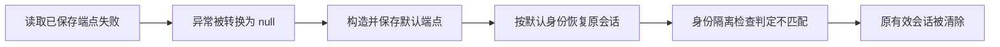

# 测试失败根因与整改方案

> 本报告保留整改前的失败基线；后续开发与复测结果见 [整改实施与模拟验收报告](REMEDIATION-IMPLEMENTATION-AND-SIMULATED-ACCEPTANCE-2026-10-20.md)。

日期：2026-10-20，Asia/Shanghai。分析基线：`de5e8ebab3a47ce583379987e4fce6e0da2cd3ab`。本报告承接《未完成测试的模拟补测与发布评估》，交付失败原因、整改顺序及复测关闭标准。

**结论：当前仍为 NO_GO。直接阻断来自旧客户端会话丢失、7 项镜像安全门禁失败，以及正式发布所需的治理和真实验收未闭环。** 既有 Glass 会话整改和最终隔离恢复已通过；本次没有把方案中的后续整改写成已完成。

本轮重新执行了旧客户端失败对照，并校验 8 份镜像原始扫描报告的 SHA-256、扫描退出码和明细计数；另查阅维护者安全公告、发布记录和上游提交。漏洞版本及公告核对截至本报告日期，实际实施时应重新核实。

## 1. 失败分别意味着什么

| 项目 | 原因 | 当前状态 | 解决方式 |
| --- | --- | --- | --- |
| 旧客户端配置读取异常 | 将读取异常转换成空配置，保存默认端点，再按默认身份恢复旧会话 | **确定的 P1 产品缺陷，仍未修复** | 为旧客户端补齐配置可信状态、会话保留、公开重读和迟到结果隔离 |
| 8 项镜像安全扫描 | 镜像包含被数据库报告为 HIGH/CRITICAL 的依赖或系统包；无合格例外记录 | **7 FAIL、1 PASS**；扫描器正常运行 | 按实际受影响范围升级、精简、纠正版本识别或完成受审 VEX，再扫描新 digest |
| 发布治理 | 预检未取得满足要求的默认分支保护、必需检查、独立评审、受保护环境及恢复 runner 证据 | 快照 **5 FAIL、3 UNKNOWN** | 由仓库/发布管理员核实和完善配置，使用可读凭据重新预检 |
| 正式签名、真机及生产恢复 | 已做实验签名、模拟器和 Moto S3 验证，尚无对应正式资源的验收证据 | **未验收** | 在正式证书、目标硬件及受控恢复环境补验收 |
| 扩展恢复前两次失败 | integration 配置把 WAL 写到本地，而基础备份在 S3，恢复仓库缺 WAL | **实验已修正并复测通过** | 保留实际配置断言，后续在生产存储重复验证 |
| 早期 CI 构建/运行失败 | Buildx 驱动、输出目录、复用工作流上下文、执行位及 Compose profiles 不匹配 | **相关工具已修复，隔离验证通过** | 保留回归，正式候选重跑完整门禁 |
| 换签名、篡改包、已有恢复卷、损坏备份被拒绝 | 安全保护按预期工作 | **对应负向测试通过** | 继续保留拒绝行为 |
| 临时签名文件删除被拦截 | 自动审批拒绝删除，工具只返回 `blocked by policy` | 本地清理未完成 | 依原环境允许的管理流程处理；不归因于 App 运行代码 |

其中，`FAIL` 是已执行后的不合格结果；`UNKNOWN` 是证据不足；`skipped` 是该任务未执行；三者均不能算通过。扫描器退出 0 只表示完成扫描，项目门禁仍可根据漏洞报告退出 1。

## 2. 旧客户端为什么会丢失登录

### 2.1 已确认的执行链

关键位置以分析基线源码为准：

| 位置 | 当前行为 | 产生的后果 |
| --- | --- | --- |
| `client/src/main.js:1352` | `runtimeConfigRepository.load()` 失败后返回 `null` | 无法区分“读取失败”和“确实没有配置” |
| `client/src/main.js:1360` | 用 `saved ?? 默认端点` 构造配置 | 原端点 A 被尚未确认的默认端点 B 替代 |
| `client/src/main.js:630` | 激活时调用 `runtimeConfigRepository.save()` | 对照实验观察到一次默认配置写入 |
| `client/src/main.js:643`、`:583` | 创建 OIDC 管理器并执行 `restore()` | 使用 B 的 issuer/clientId 检查原来属于 A 的会话 |
| `client/src/js/auth/oidc-session.js:237` | 身份不匹配时执行 `clear()` | 删除加密 session 和 transaction，用户被退出登录 |



**问题位于启动/端点激活调用链。身份隔离检查需要保留。** 去掉 issuer/clientId 校验会引入跨身份使用令牌的风险，不能作为修复。

本次重跑的结果仍为：

| 配置读取 | 会话保留 | 默认/配置保存次数 | 删除 key | 认证状态 |
| --- | --- | ---: | --- | --- |
| 成功读取 A | 是 | 1 | 无 | 正常恢复 |
| 读取拒绝 | **否** | **1** | `iot-manager.oidc-session.v1`、`iot-manager.oidc-transaction.v1` | 未认证，`SESSION_CONTEXT_CHANGED` |

实际源码 SHA-256 仍为 `0bc0b04fa5d769fea2be6aabbf4a2cd7265f92cea8952718dbba51109373e2c2`。诊断明确因“失败读取必须保留会话”的断言退出 1。

本次直接复现的是**读取拒绝**。源码中的该读取也没有本地有界等待，永久 pending 属于需要补测的另一分支，不能把本次拒绝对照冒称为旧客户端原生超时实测。

### 2.2 为什么 Glass 已通过，旧客户端仍失败

两端有独立的 `src/main.js` 和 UI。Glass 已有 `configurationVerified`、`persistProfile`、`configuration_pending` 及 `retryEndpointConfiguration()`，旧客户端仍保留上述旧流程。修复一端不会自动修改另一端。

已有旧客户端 230 项单元和 39 项严格页面用例没有覆盖这条“实际启动函数 + 实际 OIDC 管理器 + 有效旧会话 + 配置读取拒绝”的组合，所以可以出现原套件绿色、新对照失败。

### 2.3 开发方案

1. 将配置读取结果明确保存为成功、失败、超时、取消四类；成功且值为空才属于确认的空配置。启动读使用有界等待。旧端 `RuntimeConfigRepository.load()` **目前不支持参数**，必须同步改造为可禁止写入迁移的 `load({ migrate: false })`，不能只修改调用处；读取时剥离旧明文 token，确认配置及当前 revision 后再决定迁移写入，并串行化保存，避免迟到迁移覆盖新配置。
2. 未确认配置时，显示 `configuration_pending`，保留安全存储中的会话；不调用基于默认身份的 OIDC 恢复、不保存默认端点、不建立平台 API/WSS 适配器。可以呈现本地恢复界面。
3. 为旧客户端连接/登录 UI 增加“重新读取已保存设置”入口。成功读取原配置后再恢复原会话、建立认证连接；重试失败继续保留会话。
4. 对重试、手工保存端点、切换站点及退出登录统一使用现有任务/端点 revision。已失效操作的迟到结果不能覆盖新配置、改变认证或发起旧端点请求。
5. 明确切换 issuer/clientId 时继续执行原有清理与缓存隔离。首次安装无旧配置/会话时仍允许正常使用默认连接。
6. 参考 Glass 的状态语义移植，保留旧客户端 UI 和路由契约；随后再评估提取共享启动模块。不要直接覆盖两端整个 `main.js`。

主要改动范围：`client/src/main.js`、`client/src/js/ui.js`、`client/src/js/platform/runtime-config.js`、对应平台启动辅助模块，以及 `client/test/` 和页面测试。Glass 的 `src/js/platform/startup-bootstrap.js`、`src/js/platform/runtime-config.js` 与 `test/runtime-presentation.test.js` 可作为已经验证的参考。

### 2.4 关闭标准

| 新增回归 | 必须满足的断言 |
| --- | --- |
| 已登录 + 读取拒绝 | 会话字节及原配置不变；默认配置写入 0 次；平台请求 0 次；显示公开重试入口 |
| 已登录 + 超时/永久 pending | 在既有启动预算内显示恢复界面；会话保留，不永久遮挡操作 |
| 取消读取/页面退出 | 不激活身份、不写默认配置；迟到结果不产生副作用 |
| 超时后原读取迟到 | 不覆盖较新的手工配置，不触发旧身份恢复 |
| 公开重试成功/失败 | 成功恢复原身份且发送认证请求；失败仍保留会话 |
| 重试与手工切换并发 | 最后有效操作生效；旧请求、WSS 事件和缓存写入被丢弃 |
| 真正身份切换 | 原会话和原身份缓存按既有规则隔离，禁止令牌串用 |
| 首次安装 | 确认空配置时正常进入首次连接流程 |

将失败对照纳入常规 CI，而不是只保留独立诊断命令；使用实际 OIDC 管理器。修复后重跑旧客户端完整单元/页面套件，并在已安装 APK 复验读取拒绝、延迟、公开重试和浏览器取消。保留既有启动预算，不通过加长超时隐藏问题。

## 3. 镜像为什么构建成功却不能发布

### 3.1 门禁依据与准确计数

扫描候选为 `62b0938abdde6591489d2e4a912b709a33f5a1fa`，运行 [39384244657](https://github.com/xxbb11122/IotManager/actions/runs/39384244657)，清单摘要 `e80a36a30f134425e0514dd0dda97fd008b60a09575871e771e2150262fc64e2`。本次分析没有重建镜像或把旧扫描标成新的扫描。

`scripts/ci/release-tools.mjs:1229` 收集全部 HIGH/CRITICAL CVE；`:1269` 要求没有阻断 CVE，或全部存在与对应镜像 digest 匹配的有效 VEX。7 个镜像均没有满足该条件，因而返回 FAIL；6 个构建目标推送成功、8 个扫描器退出 0 不能覆盖此判定。

| 镜像 | HIGH | CRITICAL | 含修复版本条目 | 无修复版本条目 | 门禁 |
| --- | ---: | ---: | ---: | ---: | --- |
| R01 Backend | 3 | 7 | 10 | 0 | FAIL |
| R02 Caddy | 6 | 0 | 6 | 0 | FAIL |
| R03 Keycloak | 19 | 4 | 23 | 0 | FAIL |
| R04 PostgreSQL/WAL-G | 98 | 15 | 39 | 74 | FAIL |
| R05 Prometheus | 10 | 0 | 10 | 0 | FAIL |
| R06 Alertmanager | 9 | 0 | 9 | 0 | FAIL |
| R07 逻辑备份镜像 | 115 | 16 | 57 | 74 | FAIL |
| R08 卷初始化 | 0 | 0 | 0 | 0 | PASS |
| 合计 | **260** | **42** | **154** | **148** | **7 FAIL / 1 PASS** |

302 是“镜像/包/CVE 扫描条目”的数量，跨镜像去重为 **81 个 CVE ID**。同一 CVE 可在多个镜像、多个包及多个二进制出现。154 条含 `FixedVersion` 表示扫描数据库列出了修复线；148 条未列出，不能假设一次 `apt upgrade` 就全部解决。以上也不等于已经证明 81 个 CVE 在该部署中全部可利用。

### 3.2 需要实际更新的依赖和工具链

下表中的修复版本来自扫描报告；“建议”是实施候选，必须完成下载来源、兼容性、真实二进制及新扫描验证。

| 范围 | 当前镜像实际内容 | 整改方向 |
| --- | --- | --- |
| Backend OpenSSL | `libssl3/openssl 3.0.2-0ubuntu1.26` | 报告修复线 `3.0.2-0ubuntu1.30`；更新受维护 Temurin/Jammy 镜像及必要系统包，检查容器实际包版本 |
| Backend Tomcat | `tomcat-embed-core 10.1.55` | 保持现有 Spring Boot 3.5 分支时，整体对齐 Tomcat 10.1.x 组件；可评估 10.1.60，不能只换 core 留旧 websocket/el。报告列 10.1.58，但该版发布投票未通过，正式修复发布至少应取 10.1.59，并检查更新补丁 |
| Caddy、WAL-G、监控及健康探针 | Go `1.26.6` | 报告修复线为 `1.26.9/1.27.2`；当前同分支已有 `1.26.10`，优先验证该补丁并固定真实 digest，重编全部关联二进制，包括 `http-ready` |
| 多个 Go 程序 | `golang.org/x/net v0.57.0/v0.58.0`，`grpc v1.82.1` | 报告列 x/net `0.60.0`、gRPC 两条不同修复线；候选组合至少覆盖两者，例如 `x/net v0.60.0`、`grpc v1.83.2`，然后检查实际模块图和二进制元数据 |
| Keycloak 上游镜像 | `26.7.2`，内含旧 Jackson、Netty、Bouncy Castle、FreeMarker 和 pcre2 | 选取由 Keycloak 官方整体维护的修复镜像；不要逐个替换 `/opt/keycloak/lib` 的 JAR。核查 SQL Server JDBC 的版本后缀识别，避免仅按 `13.2.1` 文本判断 |
| PostgreSQL 与逻辑备份共同基底 | Debian 12.15，两个镜像各有 74 条没有修复版本 | 先更新仍在同一 PG16 主版本下可用的受维护基底和包；未解决项单独研判。如换操作系统变体，重新编译 pgvector 并验证 ABI、UID、PGDATA、TLS 及恢复 |
| 逻辑备份镜像 | 完整 PostgreSQL 服务镜像，额外带有 `gosu` 的 Go 1.24.6 | 优先制作满足备份脚本所需的 PG16 客户端镜像，减少不必要的服务器工具；保留 shell、校验/压缩/保留期处理等实际依赖并重新验证备份与恢复 |

相关文件：`deploy/Dockerfile`、`backend/pom.xml`、`deploy/Caddy.Dockerfile`、`deploy/postgres/Dockerfile`、`deploy/monitoring/Dockerfile`、`deploy/keycloak/Dockerfile`、`deploy/docker-compose.yml`，以及候选拓扑、锁定摘要和 SBOM/provenance。

Tomcat 正式发布情况见 [Apache 安全公告](https://tomcat.apache.org/security-10.html)；Go 1.26.10 的补丁发布见 [Go 官方发布记录](https://go.dev/doc/devel/release#go1.26.10)；gRPC 候选见[官方发布页](https://github.com/grpc/grpc-go/releases/tag/v1.83.2)。不要将报告中的最低修复版本当作长期固定的“绝对安全版本”。

这些镜像固定在旧 digest 和旧 Go 模块补丁线上。固定摘要提供来源可追溯性，但不会自动取得之后发布的安全补丁；更新网页/npm 依赖也不会改变已编译 Go 程序、Java 依赖或操作系统包。

### 3.3 需要研判的识别差异，不能直接算已修复

**WAL-G `CVE-2021-38599`：疑似主模块版本误识别。** 原始报告把程序识别为 `v0.0.0-20250408092559-6ea13b90a319+dirty`，而源码固定提交与上游 `v3.0.7` 一致。本次核对确认该提交包含 2021 年修复提交 `cadf598e1c2a345915a21a44518c5a4d5401e2e3` 的历史。此漏洞针对请求 libsodium 加密时未支持却静默明文处理的行为，仍需用最终 digest 验证该拒绝/加密行为，核查本地构建改动后，才能作为不受影响证据提交审核。[上游修复说明](https://github.com/wal-g/wal-g/pull/1062)

**Prometheus `CVE-2026-42154`：疑似主模块版本误识别。** 报告识别为 `v0.0.0-20260817133844-d7598b714141+dirty`；源码提交与官方 `v3.14.0` 一致，且包含修复版本 v3.11.3 的历史。维护者公告列出的修复版为 3.5.3 和 3.11.3。需进一步核对最终二进制、构建差异及隔离 remote-read 回归，不能仅更改 `--version` 文本来消除扫描项。[维护者公告](https://github.com/prometheus/prometheus/security/advisories/GHSA-8rm2-7qqf-34qm)

**Spring 的扫描评级和可利用条件需要单独记录。** 例如 CVE-2026-47890 在该 Trivy 报告中为 CRITICAL，Spring 维护者评级为 LOW，触发条件是通过 SSE 发送视图片段；CVE-2026-47884 涉及 XsltView，CVE-2026-47892 涉及特定 WebFlux functional endpoint 部署。源码静态搜索以 REST 控制器为主，未匹配上述视图类，但静态搜索不足以替代运行配置证明。评级差异本身也不足以豁免门禁。[47890 公告](https://spring.io/security/cve-2026-47890/)、[47884 公告](https://spring.io/security/cve-2026-47884/)、[47892 公告](https://spring.io/security/cve-2026-47892/)

**MCP `CVE-2026-35568` 需要核实是否启用受影响服务。** 镜像含 mcp-core 0.18.3，报告列修复版 1.0.0；维护者说明问题针对缺少 Origin 校验的 MCP 服务，并明确提到 Spring AI 的校验场景。应检查实际 MCP 路由、自动配置、Origin/Host 拒绝测试及依赖来源，再决定升级或移除未使用传递依赖。生产关闭 AI 不会自动移除 JAR。[维护者公告](https://github.com/modelcontextprotocol/java-sdk/security/advisories/GHSA-8jxr-pr72-r468)

上述四类均保持**待研判**，没有预先批准 VEX，也没有将原始 FAIL 改成 PASS。Go 标准库、x/net、gRPC 等其他真实依赖更新仍需推进。可利用路径分析可辅以 `govulncheck`；它不能代替镜像扫描或独立批准。[Go 官方说明](https://go.dev/doc/security/)

### 3.4 Spring 的兼容性决策

当前后端为 Spring Boot **3.5.16**、Spring Framework **6.2.19**、Spring AI **1.1.8**。报告对部分 Spring CVE 只列 OSS 修复线 **7.0.9**；维护者还列出 **6.2.20 企业支持版**。不能直接把 Framework 7 填入现有 Boot 3.5 的版本属性。

建议按以下顺序决策：

1. 先逐项证明实际受影响功能和配置。证实不受影响的项目进入严格的证据审核；不能仅以“代码里没搜到”通过。
2. 如果需要保持 Boot 3.5，核实是否具备合法的 6.2.x 安全补丁来源和支持，统一 BOM 后运行完整兼容测试。
3. 如果需要持续使用开源安全补丁且确实受影响，单独立项迁移到与 Framework 7 配套的受维护 Boot 4.x/Spring AI 组合，验证 Security、Jackson、JPA、数据库迁移、WebSocket、测试框架和对外 API。该组合需另做版本矩阵与开发文档。
4. 先将可以独立修复的会话问题、OS 包、Go 工具链和 Tomcat 同分支更新完成，避免一次混合所有大版本迁移。

官方 Boot 4 系统要求明确使用 Framework 7 与对应 Servlet 容器，说明这是成套兼容性变更。[Spring Boot 系统要求](https://docs.spring.io/spring-boot/system-requirements.html)

### 3.5 无修复版本与 VEX 的正确处理

对 148 条没有 `FixedVersion` 的记录，按“受影响包和版本→代码路径/配置→供应商状态→可替代基底/移除可能→补偿措施”逐项处理。当前记录包括 `affected`、`fix_deferred`、`will_not_fix`；没有版本字段不代表没有风险，也不代表需要无限等待。

对已证实的误识别或不受影响项，证据至少包含：CVE、镜像 digest、源码提交、构建修改摘要、实际二进制/包版本、上游修复与祖先关系或未启用功能的运行证据、回归结果、审核人及复查期限。

**仓库当前的 `hasApprovedVex()` 只接受 `affected-but-accepted`**，并检查 artifact/digest/CVE、reason、approvedBy、trackingIssue、补偿措施和时间。不能写一个 `not_affected` 字段就认为现有门禁会接受，也不应把“确认不受影响”伪装成“有风险但接受”。

如采用不受影响/已修复证明，需要先为 VEX schema、解析与门禁增加明确类型及证据校验，补错误 digest、缺批准、过期、缺证据等拒绝用例，并通过受保护评审确认。当前 `approvedBy` 字段的存在性检查不能代替真实独立批准；治理配置也需同步闭环。对真正受影响的例外，则按原风险接受流程给出限制、负责人和失效日期。

### 3.6 R08 为什么 PASS 仍建议维护更新

R08 的本轮 HIGH/CRITICAL 条目为 0，所以漏洞门禁 PASS；原始报告同时有 **`OS.EOSL=true`**，镜像是 Alpine 3.20.10。Alpine 官方列出该分支常规支持已于 **2026-04-01** 结束。建议更新到处于维护期的稳定分支并固定新 digest，复验 chown、UID、只读根文件系统和三类初始化卷；该维护项不能伪装成本轮扫描 FAIL，也不能因零条目忽略维护状态。[Alpine 官方维护周期](https://alpinelinux.org/releases/)

## 4. 扩展恢复曾经为什么失败、现在如何防复发

前两轮恢复取到了 S3 基础备份，但 PostgreSQL 请求的起始 WAL `00000001000000000000000B` 不在该仓库，180 秒内未就绪。`deploy/docker-compose.integration.yml` 三个服务硬编码 `WALG_STORAGE_MODE: filesystem`、`WALG_FILE_PREFIX: /var/lib/wal-g`，覆盖了实验设置的环境变量。

已实施的实验修正是：源库初始化前建 S3 仓库，显式修改 integration fixture 的三处存储选择，保留修改前后摘要，检查归档和基础备份容器的实际参数一致，等待首份定时备份和新 WAL 边界。没有删掉 WAL 验真或放宽恢复成功标准。

最终 [39390895513](https://github.com/xxbb11122/IotManager/actions/runs/39390895513) 已验证：源表清空为 0 行后，从基础备份及 WAL 恢复 32,768 行/64 MiB，指纹一致；源/候选/恢复 Flyway 均 28；13/13 服务摘要一致；已有卷和损坏备份被拒绝。

后续建议把文件仓库与 S3 测试覆盖层显式分开，避免运行时字符串替换长期作为配置接口；对最终 Compose/container 配置、同 bucket/prefix、所选基础备份及所需 WAL 做前置断言。替换测试 fixture 后仍需重跑同样恢复闭环。生产验收应使用真实 IAM 和业务批准规模，记录全业务恢复时长；本轮约 9.80 秒仅为数据库实验计时。

## 5. 治理与真实验收如何关闭

治理依据为 `2026-10-20 16:09:47 +08:00` 的只读快照；它描述当时 API 能验证的结果，不推断 UNKNOWN 项一定不存在。

| 控制项 | 快照 | 整改及证据 |
| --- | --- | --- |
| 默认分支保护 | FAIL | 管理员核实有效规则/ruleset 及 API 可见性 |
| 必需 quick-gate | FAIL | 将实际稳定检查名设为必需并验证合并约束 |
| 独立评审 | FAIL | 配置独立批准、过期批准失效，并完成本次候选评审 |
| 管理员绕过/强推/删除保护 | UNKNOWN | 用有权读取的凭据检查，不以猜测填 PASS |
| `r1-recovery-drill` | FAIL | 保护分支、环境批准及执行权限符合既有门禁 |
| `r1-rollback-drill` | UNKNOWN | 核实环境、独立审批和分支限制 |
| `android-release` | UNKNOWN | 核实正式签名环境、证书指纹和来源验证 |
| 恢复专用 runner | FAIL | 专用 runner 在线、标签完整、权限和隔离满足现有要求 |

正式验收还需四组可交付证据：

1. **签名/分发**：正式证书指纹、不可调试 APK/AAB、可信来源与资源摘要；正常覆盖升级保留真实数据；渠道安装后身份正确。签名密钥不进入仓库或报告。
2. **目标硬件**：目标手机/PDA 的冷启动、后台/进程恢复、浏览器登录与取消、低存储/弱网、BLE 发现/配对/断连、定位权限；用目标设备记录性能。
3. **生产恢复**：独立恢复环境使用真实存储 IAM、基础备份与 WAL、批准规模和清理后 PITR，完成身份/设备/命令/读写探针，按业务批准的 RPO/RTO 判定。
4. **发布链**：新候选同一 SHA/release ID/digest 的扫描、SBOM/provenance、运行态、恢复/回退及最终 Release Integrity Gate；运维批准灰度、监测、停止和回退条件。

AI/知识库若继续保持生产关闭，可在发布范围明确排除；开启时补真实供应商验收。原 R1 内部告警配置保持其既有范围，不因本报告新增外部通知要求。

## 6. 实施顺序与验收交付

| 顺序 | 工作包 | 建议负责角色 | 完成标准 |
| --- | --- | --- | --- |
| 1 | 旧客户端 P1 修复及常规 CI 补洞 | 客户端开发 | 第 2.4 节全部场景通过，实际已安装 APK 复测；身份隔离保持有效 |
| 2 | 81 个 CVE 按 digest 建立研判台账 | 后端/平台 + 独立安全评审 | 每项有影响结论、包路径、处置、证据和负责人；误报推断不自动批准 |
| 3 | Go/OS/Tomcat 同分支更新及备份镜像精简 | 平台/后端 | 实际包与二进制版本、功能和负向测试通过，新 digest 扫描无未处置阻断 |
| 4 | Keycloak 官方维护镜像升级 | 身份服务维护者 | PKCE、四角色、刷新/退出/撤销、证书/WSS 联调通过 |
| 5 | Spring/MCP 兼容性决策及必要变更 | 后端开发 + 安全评审 | 合法补丁来源或已批准的不受影响证据；需要迁移时单独完成兼容矩阵 |
| 6 | 仓库/发布环境治理及正式资源验收 | 管理员/发布/测试/运维 | 治理 0 FAIL、0 UNKNOWN；正式签名、硬件、恢复证据齐备 |
| 7 | 冻结新候选并重跑完整发布链 | 发布负责人 | 来源绑定一致，所有必需门禁通过或具有合法例外，并完成独立批准 |

单次提交完成的自包含工作包先验收，再合并到候选；对镜像变更重新生成清单，不能继续复用旧候选的 13 服务成功记录作为新 digest 的运行证明。修复与例外记录均不得降低 HIGH/CRITICAL 门槛、全局忽略 CVE、仅删除扫描元数据，或由测试作者冒签批准。

可以保留当前客户端 JS/Capacitor 结构和 Glass 页面方案开展整改。现有证据支持修复具体启动状态机和供应链维护流程；没有证据要求重做整套 App UI 框架。

## 7. 本报告的证据与复现

本机证据根目录：`E:/CC_testP/iot-manager/artifacts/remaining-simulation-20261020/`。

| 文件 | 用途 |
| --- | --- |
| `legacy-session-cause-confirmation.json/.log` | 本次以 de5e8eb 重跑的实际旧客户端对照，仍 exit 1 |
| `failure-root-cause-data.json` | 校验报告摘要后的 8 镜像计数、302 条原始条目及待研判分类 |
| `image-remediation-findings.csv` | 按镜像/包/CVE 导出的 302 条版本、修复线、来源与研判方向；不含批准结论 |
| `analyze-failures.mjs` | 本次分析的计数、SHA-256 及失败断言校验入口 |
| `walg-patch-ancestry.json`、`prometheus-patch-ancestry.json`、`prometheus-source-tag.json` | 本次只读核对的上游修复祖先关系与版本提交；不等同于最终二进制不受影响批准 |
| `image-security-ci/` | 原始扫描 JSON、每镜像门禁结果、候选清单及摘要 |
| `immutable-recovery-final-ci/` | 最终 S3 配置、64 MiB 数据、PITR、13 服务和拒绝测试证据 |
| `governance.json`、`local-cleanup.json` | 治理快照与清理边界 |

复现旧客户端缺陷，在仓库根目录执行：

```powershell
node scripts/validation/legacy-session-probe.mjs --output artifacts/remaining-simulation-20261020/legacy-session-cause-confirmation.json
```

修复前会因会话保留断言失败退出 1；修复后必须改为该预期通过，不能将“发现问题”计为产品通过。为避免污染后续构建身份，本次报告归档单独提交，App 业务源码及冻结镜像保持原有身份。

临时实验签名文件的删除仍被自动审批拦截，唯一已知原因是 `blocked by policy`，没有更具体说明。文件在本机关闭继承的受限目录、由 Git 忽略且未上传，公钥证书另存；该项单独列为本地清理待办，不影响已取得的 SDK 验签结果，也不能声称已经删除。
